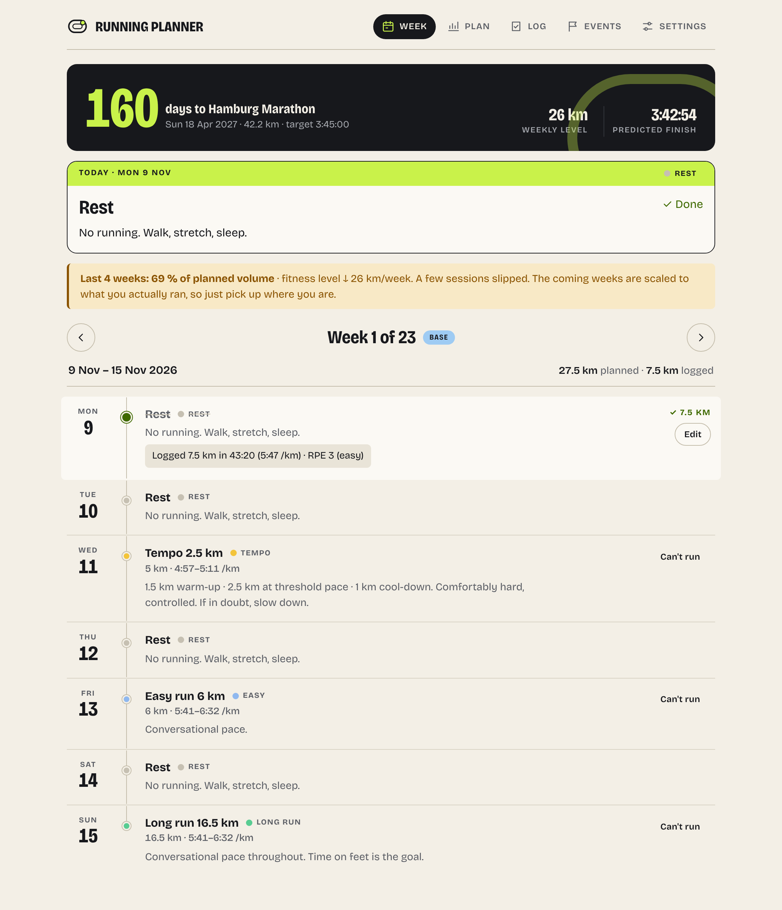
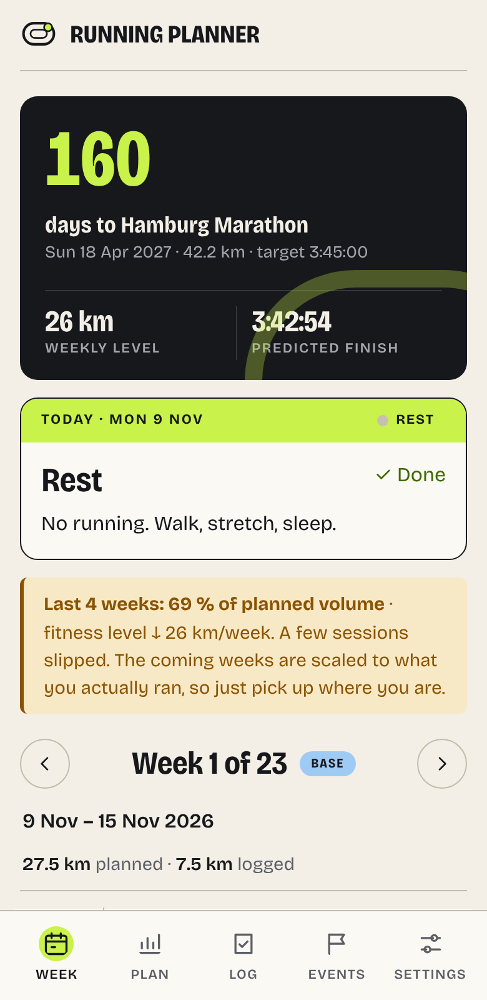
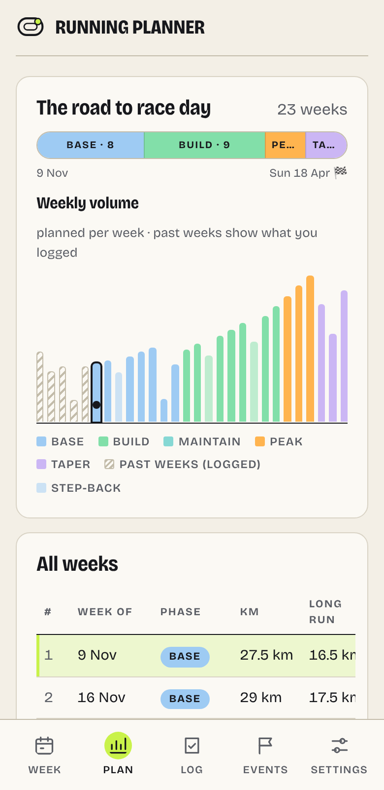
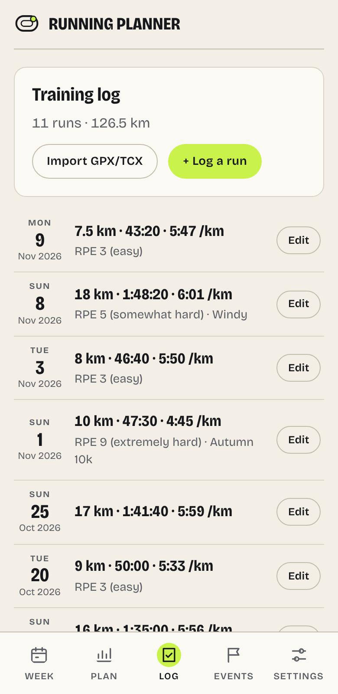

# Running Planner

An adaptive marathon training plan that lives entirely in your browser. No account, no server.

**Live app:** https://elkei24.github.io/running-planner/

<picture>
  <source media="(prefers-color-scheme: dark)" srcset="docs/screenshots/week-dark.png">
  
</picture>

- Enter your goal race, your current weekly volume and how many days you can run.
- Get a periodised plan (base → build → peak → taper) with paces derived from a recent race.
- Log your runs. Skip a week, go on holiday, add a tune-up race: the plan adjusts itself, because it
  is recomputed from your log and calendar every time you open it.
- Export a JSON backup or an `.ics` calendar. Works offline once loaded (PWA).

<p>
  
  
  
</p>

## Development

Requires Node 26 (see `.nvmrc`).

```sh
npm ci
npm run dev        # http://localhost:5173
npm run check      # typecheck + lint + tests + build
npm run test:watch
```

Time-travel for manual testing: append `?today=2027-01-18` to the URL.

## How it works

The plan is never stored. The app stores only your inputs (athlete, goal, events, log) and derives
the schedule with a pure function, `plan(state, today)`. See [docs/architecture.md](docs/architecture.md)
for the design, [docs/training-science.md](docs/training-science.md) for the training principles and
their sources, and [docs/decisions](docs/decisions) for the decision records.

## Contributing, releases and deployment

All changes go through pull requests that are **squash merged** into `main`. The PR title becomes
the commit message and must follow [Conventional Commits](https://www.conventionalcommits.org/)
(`feat: ...`, `fix(planner): ...`, `feat!: ...`); a workflow checks it. Every PR runs CI (typecheck,
lint, tests with coverage, build).

Every push to `main` runs the release workflow:

1. [semantic-release](https://semantic-release.gitbook.io/) works out the next version from the
   commits since the last tag: `feat` bumps the minor version, `fix`/`perf`/`refactor`/`build` the
   patch version, a `!` after the type or a `BREAKING CHANGE:` footer the major version. `docs`,
   `test`, `ci`, `chore` and `style` commits do not release.
2. If a release is due, it tags `main` (`vX.Y.Z`) and creates a GitHub release with generated notes.
3. That tag is built with `APP_VERSION=X.Y.Z` and `BASE_PATH=/running-planner/` and deployed to
   GitHub Pages. The settings page shows the version; development builds show `dev-<commit>`.

To redeploy an existing release, run the *Release* workflow manually with its tag.

The *Renovate* workflow runs [Renovate](https://docs.renovatebot.com/) on Monday mornings and
opens dependency update PRs. Minor, patch and digest updates come as one grouped PR that merges
automatically when CI is green; major updates get their own PRs and wait for a manual merge.

One-time repository setup, after this workflow has landed on `main`: run
`scripts/github-setup.sh` (needs the GitHub CLI) or apply the same in the settings UI: squash
merge only with the commit message taken from the PR title and description, a ruleset on `main`
that requires a PR and the *Typecheck, lint, test, build* and *Validate PR title* checks, and
*Pages → Source* set to **GitHub Actions**. For Renovate, create a fine-grained personal access
token for this repository with read and write access to commit statuses, contents, issues, pull
requests and workflows, and store it as the `RENOVATE_TOKEN` repository secret
(`gh secret set RENOVATE_TOKEN`).

## License

MIT, see [LICENSE](LICENSE).
